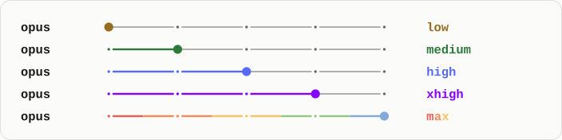
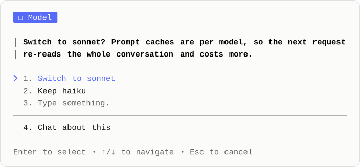

<div align="center">

# shifter

**Changing effort shouldn't take any.**

Model and effort on one line above your Claude Code prompt.<br>Press a key and keep typing. Effort becomes a per-prompt choice, and the cheaper settings get used.

<br>

<picture>
  <source media="(prefers-color-scheme: dark)" srcset=".github/assets/hero-dark.svg">
  
</picture>

<sub>Recorded from a real session. The key legend is the only addition.</sub>

</div>

<br>

Run these inside Claude Code, one at a time:

```text
/plugin marketplace add DustinVerzal/claude-shifter
/plugin install shifter@shifter
/reload-plugins
/shifter-keys
```

Then restart Claude Code. `/shifter-keys` adds the keys to `~/.claude/keybindings.json`, and without them shifter draws but no key moves it. It keeps everything already in that file: if a key is bound to something else, it leaves that binding in place and tells you which action still needs a key.

<details>
<summary><strong>The keybindings, to add by hand</strong></summary>

```json
{
  "bindings": [
    {
      "context": "Global",
      "bindings": {
        "ctrl+1": "strip:jump1",
        "ctrl+2": "strip:jump2",
        "ctrl+3": "strip:jump3",
        "ctrl+4": "strip:jump4",
        "ctrl+5": "strip:jump5"
      }
    },
    {
      "context": "Chat",
      "bindings": {
        "shift+left": "command:dot-left",
        "shift+right": "command:dot-right",
        "shift+up": "command:dot-up",
        "shift+down": "command:dot-down"
      }
    }
  ]
}
```

`strip:jump*` is an undocumented action with no handler in a normal session. If a release starts handling it, `ctrl+1` … `5` will need a new version of shifter.

</details>

## Why I built it

I kept Opus on xhigh for everything. A rename doesn't need that, but changing it meant setting my draft aside, typing two slash commands, and adding two lines to my transcript. Each one also saved itself as my default for new sessions, so a quick rename changed tomorrow too:

```text
❯ /effort low
  ⎿  Set effort level to low (saved as
     your default for new sessions):
     Quick, straightforward…

❯ /model sonnet
  ⎿  Set model to `Sonnet 5.5` and
     saved as your default for new
     sessions
```

So I left them alone.

Once it was one keystroke, I stopped choosing once a project and started choosing every prompt. I lower effort for small asks and raise it for hard ones. Haiku and low effort finally get used, and they take less of my limit.

| | `/effort` and `/model` | shifter |
| --- | --- | --- |
| Your half-written prompt | Has to be set aside | Stays in the input |
| Transcript | A new line each time | Nothing |
| `settings.json` | Saved as your default, except `/effort max` | Never written |
| How long it lasts | Until you change it again | This session, including `/clear` |

## Use it

<kbd>shift</kbd> + <kbd>←</kbd> <kbd>→</kbd> moves along effort.<br>
<kbd>shift</kbd> + <kbd>↑</kbd> <kbd>↓</kbd> moves between models, asking first once a conversation has a reply.<br>
<kbd>ctrl</kbd> + <kbd>1</kbd> … <kbd>5</kbd> jumps to an effort level.

## Native on purpose

<picture>
  <source media="(prefers-color-scheme: dark)" srcset=".github/assets/levels-dark.svg">
  
</picture>

It's drawn with Claude Code's own components and theme keys, so it follows your theme, light or dark. The colors are the `/effort` slider's, and `max` takes the engine's ultrathink rainbow. Unlike the slider, they hold still, because this sits above your prompt all session.

At rest it's two words, `opus high`. An effort key stretches them into a bar with the effort names above it, a model key unfolds the full grid, and either one folds itself away a moment later. The dot keeps its column from the bar to the grid.

There are no dependencies, no background process, and no status line to configure.

## It asks before it costs you

<picture>
  <source media="(prefers-color-scheme: dark)" srcset=".github/assets/dialog-dark.svg">
  
</picture>

Prompt caches are per model, so the request after a switch costs more. Once a conversation has a reply, shifter asks first, and nothing moves unless you agree. One yes covers every move until your next request, so you can walk past a model without answering twice. Effort changes never ask.

## Good to know

- **Your other controls still win.** `/effort <level>` moves the dot straight away. The `/effort` slider, `/model` and the picker move it on your next request.
- **Subagents stay on the session's model.** Only your main requests move, and Claude Code's banner keeps naming the session's model.
- **It's keyboard only.** shifter adds nothing to click.
- **`ctrl+1` … `5` need a terminal that reports those keys.** Not all of them do.
- **To remove it,** run `/plugin uninstall shifter@shifter` and delete the bindings.
- **Tested on Claude Code 2.1.318.**

<br>

<sub>To work on it, `claude --plugin-dir .` runs the mod from a clone and hot-reloads on save. [AGENTS.md](AGENTS.md) has the rules. [MIT](LICENSE).</sub>
